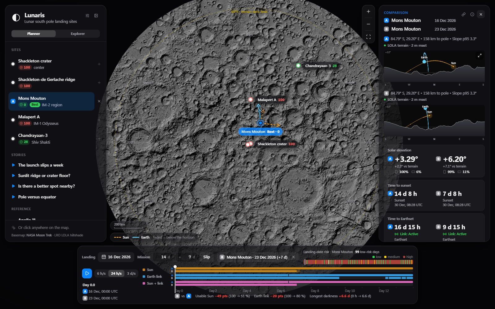
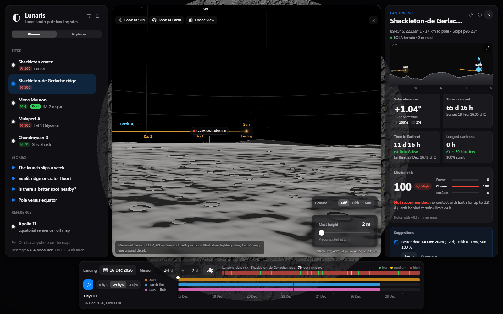
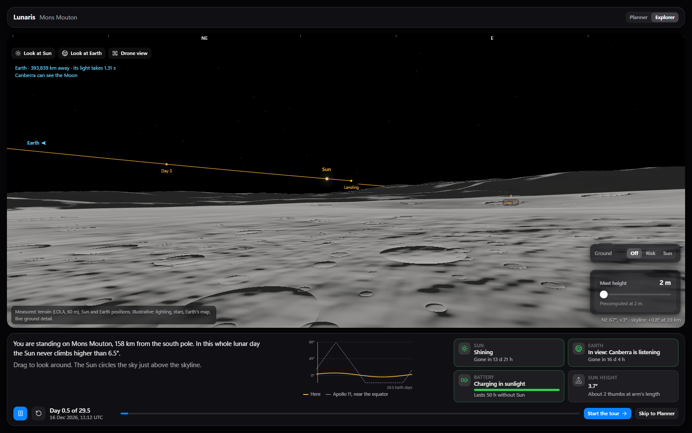

# Lunaris: lunar south pole landing site comparison

**NASA Space Apps Challenge 2026.** A web tool that shows mission planners, educators and
the public how the Sun and the Earth move around the horizon at a lunar south pole landing
site. It tells them in seconds what a slipped date or a nearby spot does to power and to
direct-to-Earth communication.

**Live site:** https://lunaris-lovat.vercel.app/



## The problem

Near the lunar south pole the Sun never rises more than a few degrees above the horizon, and
the Earth rises and sets with the Moon's libration. A hill a few kilometres away can shadow
a lander for days, and moving the landing by a week or a few hundred metres can turn a safe
mission into a lost one. JPL Horizons, Moon Trek and QuickMap hold the data, but answering
"the launch slipped a week, what now?" means juggling several expert interfaces and raw
tables.

Lunaris turns that question into one click. For example, a 14-day mission landing on Mons
Mouton on 16 December 2026 has 100 % usable Sun and risk 0. Seven days later it has 51 %
usable Sun, 6.6 days of continuous darkness and risk 100. Twenty-eight days later it is back
to risk 0.

## What you can do

**Planner (for mission planners)**

- **Pick a site or any point.** Five curated south polar sites (Shackleton crater,
  Shackleton-de Gerlache ridge, Mons Mouton / IM-2 region, Malapert A / IM-1, Chandrayaan-3)
  and Apollo 11 as an equatorial reference. Clicking anywhere between 60°S and the pole gives
  the same assessment for that point, with its real terrain horizon from a live terrain
  service.
- **See the Sun and the Earth against the real skyline.** A horizon panorama built from
  LOLA topography. Solar elevation (also relative to the terrain), time to sunset and
  Earthset, visible share of the solar disk, and which Deep Space Network complex can see
  the Moon.
- **Compare scenarios side by side.** Scenario A and B can differ in site, landing date or
  both. A "slip" control sets B to A plus N days. A timeline with an animation player
  (6 h/s, 24 h/s, 3 d/s) shows Sun, Earth link and both together over the mission.
- **Get a transparent risk score.** Power (longest darkness against battery life, usable
  Sun), communication (longest outage, daily contact time) and surface (slope within the
  landing precision) are each scored 0-100, and the worst category is the overall score.
  The score comes with a plain-language verdict and with "holds with the map's height
  error", a re-run on a horizon raised by the LOLA height uncertainty.
- **Find alternatives.** A landing-date strip colours every landing date up to 2030 by
  risk. "Suggestions" proposes a better date close in time and a better spot within
  ±500 m. The spot comes from an 81-point grid scored live for the mission on screen and
  shown as a heat map.
- **Tune the mission.** Profile presets (generic, solar lander, battery rover with the
  numbers from NASA's VIPER page), sliders for darkness survived, usable Sun, longest
  outage, daily contact and slope limit, mission length from 1 to 60 days, and mast height.
- **Share the scenario.** Every scenario is a link: site, date, comparison, slip, profile
  and limits are kept in the URL. Custom points can be saved in the browser.

**3D surface view**



A first-person view on real LOLA terrain (four nested height levels, 60 m to 3.8 km
pixels) with shadows computed on the GPU. The Sun's and the Earth's paths over the mission
are drawn as tracks, solid where the place sees the body and dashed where the skyline
hides it. A drone view circles the site and shows a generic lander at true size. The ground
can be tinted by risk or by usable Sun of the surrounding grid. Users can hop to a
neighbouring grid point. What the view shows as visible always comes from the same
horizon computation as the numbers. Ground detail, stars and the Earth's surface map are
illustrative, and the view says so.

**Explorer (for students and the public)**



- A short introduction and a four-step guided tour. Each step pairs the 3D view with live
  cards: is the Sun shining, how long the battery lasts without it, which DSN antenna is
  listening, and how high the Sun is in "thumb widths at arm's length".
- A comparison with Apollo 11 near the equator: there the Sun climbs to almost 90°, at the
  pole it stays a few degrees above the skyline.
- **A landing game.** Three missions with fixed dates. Players use three scout flights to
  pick a spot that survives the mission without running out of battery or tipping over on a
  steep slope, and earn up to three stars.
- "Stories" in the Planner are one-click comparisons: the launch slips a week, a sunlit
  ridge against a crater floor, a better spot nearby, the pole against the equator.

The layout works on phones (sheets instead of side panels). The 3D view lowers its drawing
resolution on slow GPUs and draws a full-quality frame whenever the view is at rest.

## How it works

```
 JPL DE421 ephemeris ──► Skyfield (Python) ──► hourly Sun / Earth vectors, 2026-12 to 2030-12
 DSN complex positions ─────────────────────► Moon elevation at Goldstone, Madrid, Canberra
 LOLA 60 m topography ──► terrain horizon (720 azimuths, out to 250 km), slope, height error
                                │
                                ▼
            precomputed files in data/  ──►  web app (React + TypeScript)
                                              • risk engine runs in the browser
                                              • Leaflet map on NASA Moon Trek tiles
                                              • three.js surface view
            live terrain service (FastAPI on Google Cloud Run) ──► horizon + slope
            for any clicked coordinate (reads LOLA GeoTIFFs by HTTP range requests)
```

- **Sky.** Skyfield with JPL DE421 and the DE421 lunar orientation kernels, in the Moon's
  mean-Earth frame (`MOON_ME_DE421`). One hourly table of Sun and Earth vectors serves every
  point on the Moon, so the browser can compute azimuth and elevation for any coordinate.
  Libration and the Moon's orbital variations are included because they are part of the
  ephemeris and the orientation model. Disk radii of the Sun and the Earth come from their
  distance at each instant.
- **Horizon without an atmosphere.** No refraction. The horizon in each of 720 directions
  is the highest terrain elevation angle seen from the observer (mast height above ground,
  default 2 m), with lunar curvature. Rays are sampled every 60 m to 20 km on the
  full-resolution DEM, then on a 240 m grid out to 250 km. The limb of the sphere is
  therefore part of the horizon. A body counts as visible while its upper limb clears the
  terrain.
- **Power.** The visible share of the solar disk after terrain and after the Earth's disk,
  which also captures eclipses by the Earth (one is found on 2027-08-17). Indicators: usable
  Sun, longest continuous darkness, grazing-Sun hours.
- **Communication.** The Earth must clear the terrain, a DSN complex must see the Moon above
  10°, and there must be no solar conjunction (Sun within 2° of the Earth seen from the
  lander, or of the Moon seen from the Earth). Indicators: link share, longest outage,
  contact on the worst day, and hours lost to terrain, station gaps and conjunction.
- **Surface.** 95th-percentile slope from the LOLA 60 m slope map within the landing
  precision (100 m).
- **Same model on both sides.** The risk model was written in Python and ported to
  TypeScript, so dates, profiles, scans and comparisons never hit a server. A validation
  script checks that the browser engine reproduces the Python results for every site and
  every landing date of the year.

## Validation

| Check | Result |
| --- | --- |
| Skyfield against JPL Horizons, three sites, December 2026, hourly, Sun and Earth | max difference ≤ 0.00002° |
| Rise and set times against one-minute Horizons tables, one year, all sites | sphere: median 0.0 min, Earth max 0.1 min; terrain: median ≤ 0.2 min |
| Browser engine against the Python backend (`npm run validate`) | identical for all sites, all 352 landing dates of the year |
| Site-independent vector table against per-site tables | within 0.00003° |
| Live terrain service against the local computation | identical horizon and slope |
| Malapert A ground height | +2592 m, matches IM-1's reported landing elevation (~2.6 km) |
| **Backtest on a flown mission:** Chandrayaan-3, landed 2023-08-23 | the real landing date scores risk 0 and lies inside the model's low-risk window (21-24 Aug). The model's sunset (2023-09-04 07:17 UTC) matches the day ISRO put the lander to sleep (`python lunar_sky.py backtest`) |

## Results for one landing date

14-day mission landing on 16 December 2026, default profile, terrain and DSN:

| Site | Usable Sun | Longest darkness | Longest outage | Slope p95 | Risk (power / comm / surface) | Low-risk landing dates per year |
| --- | --- | --- | --- | --- | --- | --- |
| Mons Mouton | 100 % | 0 h | 1 h | 3.3° | 0 / 0 / 0, **low** | 21 |
| Chandrayaan-3 | 89.9 % | 32 h | 1 h | 1.2° | 28 / 0 / 0, **low** | 37 |
| Shackleton-de Gerlache ridge | 100 % | 0 h | 2.3 d | 2.7° | 0 / 100 / 0 | 11 |
| Malapert A | 81.0 % | 2.6 d | 1 h | 13.1° | 100 / 0 / 100 | 0 |
| Shackleton crater floor | 0 % | 14 d | 14 d | 5.4° | 100 / 100 / 8 | 0 |

The ridge has Sun almost all year but loses the Earth behind the terrain for days. Malapert
A fails on slope and darkness, yet a point 2 km south-east scores 0 with 52 low-risk dates a
year. Near the pole, each degree of horizon costs about 24 points of yearly sunlit time.

## Running it locally

Tested with Python 3.13 and Node.js 24.

```bash
# Backend (computation core); the JPL kernels (19 MB) download on first use
python -m venv .venv
.venv/bin/pip install -r requirements.txt        # Windows: .venv\Scripts\pip
.venv/bin/python lunar_sky.py sites
.venv/bin/python lunar_sky.py risk --site mons_mouton --landing 2026-12-16

# Web app (reads the precomputed files in data/)
cd web
npm install
npm run dev          # development server
npm run validate     # browser engine against the backend results
npm run build        # static site in web/dist
```

Custom points need the terrain service. Set `VITE_TERRAIN_API` in `web/.env.local` to a
running instance (`uvicorn api.main:app` from the repository root, with
`api/requirements.txt` installed). Without it, custom points use the smooth-sphere model and
the app says so. The LOLA height map (`LDEM_60S_60MPP_ADJ.TIF`, 2.9 GB) can be placed in
`data/lola/` for fast local terrain. Otherwise the code reads only the parts it needs from
the remote file.

Main commands of `lunar_sky.py`: `compute`, `horizons`, `compare`, `events`, `metrics`,
`horizon`, `dsn`, `risk`, `rank`, `nearby`, `grid`, `mast`, `vectors`, `patch`, `backtest`.
Each takes `--site <key>` or `--lat/--lon`.

### Repository layout

| Path | Content |
| --- | --- |
| `lunar_sky.py` | CLI, Skyfield geometry, JPL Horizons client, DSN station table |
| `lunar_terrain.py` | LOLA reads, terrain horizon, slope, permanently shadowed region access, 3D terrain windows |
| `lunar_risk.py` | power and communication state per hour, mission indicators, risk score, date scan |
| `lunar_metrics.py` | rise and set events, visibility windows |
| `api/` | terrain service (FastAPI, Docker, Cloud Run deployment script) |
| `data/` | precomputed results the web app reads |
| `web/` | the web app (Vite, React, TypeScript, Leaflet, three.js, Radix UI) |

## Limitations

- **The risk limits are assumptions, not certified values:** 50 h of battery, 24 h maximum
  outage, 10° slope, 50 % minimum Sun, 8 h of contact per day. Every limit can be changed in
  the app. The score is a transparent heuristic for comparison, not a flight-safety metric.
- Site coordinates are approximate. Near the pole results change within a kilometre. The
  ridge coordinate (Mazarico et al. 2011) is not confirmed against the paper.
- Terrain comes from 60 m pixels: boulders and craters smaller than that are not seen. The
  horizon-uncertainty check uses the LOLA formal height error.
- Hourly sampling: durations in the risk model are counted in whole hours.
- Power is the visible solar-disk share only (no panel orientation, no thermal model).
  Communication assumes the three DSN complexes with a 10° mask (station coordinates
  approximate) and treats a partly visible Earth as visible.
- Out of scope: approach-corridor clearance, seismic and landslide hazard, electrostatic
  dust, infrared heating from crater walls, solar particle events.
- Terrain is available from 60°S to the pole (the extent of the LOLA product used).

## Data sources and references

- **Ephemeris:** JPL DE421 planetary ephemeris and lunar orientation kernels
  (`de421.bsp`, `moon_pa_de421_1900-2050.bpc`, `moon_080317.tf`, `pck00008.tpc`) from the
  NAIF generic kernels, https://naif.jpl.nasa.gov/pub/naif/generic_kernels/ . Folkner, W. M.,
  Williams, J. G., Boggs, D. H. (2008), *The Planetary and Lunar Ephemeris DE 421*, JPL IPN
  Progress Report 42-178.
- **Skyfield** (Brandon Rhodes), https://rhodesmill.org/skyfield/ . Lunar surface frames:
  https://rhodesmill.org/skyfield/planetary.html
- **JPL Horizons System** (validation), https://ssd.jpl.nasa.gov/horizons/ and API
  https://ssd-api.jpl.nasa.gov/doc/horizons.html
- **LOLA south pole topography:** "A New View of the Lunar South Pole from LOLA", NASA GSFC
  Planetary Geodesy Data Archive, https://pgda.gsfc.nasa.gov/products/90 . Products used:
  `LDEM_60S_60MPP_ADJ` (height), `LDSM_60S_60MPP_ADJ` (slope), the height-error and
  effective-resolution layers, `LPSR_80S_20MPP_ADJ` (permanently shadowed regions).
  Barker, M. K., et al. (2021), *Improved LOLA elevation maps for south pole landing sites:
  Error estimates and their impact on illumination conditions*, Planetary and Space
  Science 203, 105119.
- **Basemap:** NASA Moon Trek, south pole WMTS tiles (LRO LOLA hillshade),
  https://trek.nasa.gov/moon/ and https://trek.nasa.gov/tiles/apidoc/trekAPI.html?body=moon
- **Polar illumination:** Mazarico, E., Neumann, G. A., Smith, D. E., Zuber, M. T.,
  Torrence, M. H. (2011), *Illumination conditions of the lunar polar regions using LOLA
  topography*, Icarus 211(2), 1066-1081.
- **Deep Space Network** complexes: Goldstone, Madrid, Canberra (approximate coordinates).
- **Mission profiles and landing sites:** NASA VIPER lunar operations (50 h darkness, 15°
  slope for the rover preset); LROC / NASA release for IM-1 Odysseus at Malapert A; IM-2
  landing point at Mons Mouton; IAU Gazetteer of Planetary Nomenclature (Shackleton);
  ISRO statements reported in the press for Chandrayaan-3 (Statio Shiv Shakti) and the dates
  of its sleep and wake-up attempts.
- **Open-source software:** Skyfield, NumPy, rasterio / GDAL, FastAPI, React, Vite,
  Leaflet, three.js, Radix UI, lucide icons, react-day-picker.

## Use of AI

We used **Claude Code** (Anthropic) as a coding assistant during the hackathon. It helped
write and review code, run checks and draft documentation, including this README. No other
AI tools were used. The team chose the approach, the physical model, the risk rules and
the design, and checked the results against JPL Horizons, the Python reference
implementation and a flown mission (see Validation). No numbers in the app are generated
by AI: they are computed from the NASA and JPL data listed above.

## License

The code is released under the [MIT License](LICENSE). The ephemeris, topography and
basemap data come from NASA and JPL (see Data sources) and remain subject to their own terms.

## Team

- Kerem Sabri Gül ([@KeremGull](https://github.com/KeremGull)): backend, computation core
- Sezer Gümüş ([@Sezergumus](https://github.com/Sezergumus)): frontend, web application
